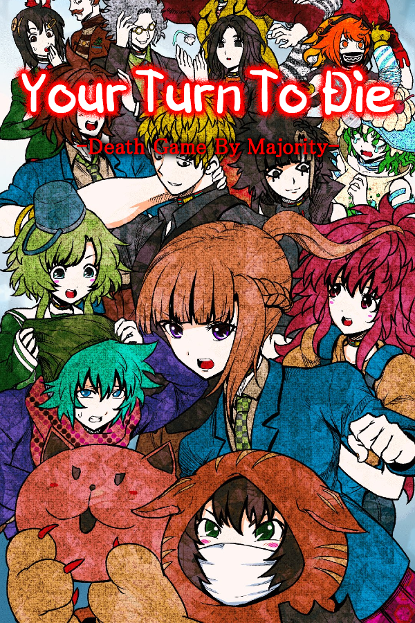

# Your Turn To Die — Nintendo Switch (nx.js wrapper)


<p align="center">
  
</p>

A loader that runs the RPG Maker MV web build of *Your Turn To Die* on
Nintendo Switch via [nx.js](https://github.com/TooTallNate/nx.js).
**No game files are included in this repository.**

## Install

1. Download the official game ZIP from
   [vgperson](https://vgperson.com/games/YourTurnToDie.zip) and place it,
   unextracted, at `sdmc:/switch/yourturntodie/YourTurnToDie.zip`.
2. Copy the NRO from the
   [latest release](https://github.com/sukalibur9/yttd-nx/releases) to
   `sdmc:/switch/yourturntodie/`.
4. Launch from the Homebrew Menu in application mode (hold R when
   launching a title) or use [Sphaira](https://github.com/NaGaa95/sphaira), find the nro, press X to open Options and choose Install Forwarder. Make sure Address Space is set to 39-bit, choose Create Forwarder, then start the game from the Home Screen.
5. Optional: create `sdmc:/switch/yourturntodie/config.txt` containing
   `debug=1` to write `debug.log` next to it (default is off).

## Controls

- Left stick: on-screen cursor
- ZL / ZR: click at the cursor
- A: confirm
- B: cancel, D-pad: move
- Touchscreen works as well.

## Build

Requires Node.js:

```
cd yttd
node build.mjs
npx nxjs-nro --fat
```

Place a 256x256 JPEG at `yttd/icon.jpg` to embed a homebrew-menu icon.

## Notes

- The loader reads the game ZIP at runtime; it never modifies game files.
- The loader maps the official ZIP's `www/` layout and handles its
  `.rpgmvp`-encrypted images.
